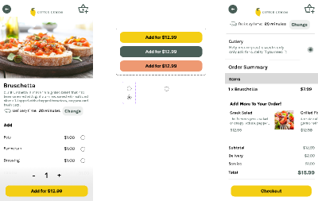

# Little Lemon Mobile 🍋

A mobile app for the Little Lemon restaurant, built with Expo and React Native. Browse the menu, filter by category, and book a table.

## Table of contents

1. [Table of contents](#table-of-contents)
2. [Overview](#overview)
   - [Screenshot](#screenshot)
   - [Design templates](#design-templates)
   - [Links](#links)
3. [Project structure](#project-structure)
4. [Getting started](#getting-started)
5. [Tech stack](#tech-stack)
   - [Framework](#framework)
   - [UI libraries](#ui-libraries)
   - [Linters, formatters](#linters-formatters)
   - [Testing](#testing)
6. [Useful resources](#useful-resources)
7. [Author](#author)

## Overview

Little Lemon Mobile is a restaurant app with two main flows:

- **Home**: hero section, menu search, category filter and menu item cards.
- **Reservations**: a validated booking form (date, time slot, party size), a confirmation modal and a success screen. Data is served by mock APIs under `src/features/reservations/api`.

Runs on iOS, Android and web (static output via Metro).

### Screenshot



> Replace with real app screenshots once available.

### Design templates

- Assignment prototype: [`src/assets/designs/Assignment prototype.png`](<./src/assets/designs/Assignment prototype.png>)
- UI kit: [`src/assets/designs/Ui kit.svg`](<./src/assets/designs/Ui kit.svg>)

### Links

- GitHub repository: <https://github.com/KC900201/little_lemon_mobile>

## Project structure

```text
.
├── app.json                 # Expo config (icons, splash, plugins, typed routes)
├── babel.config.js          # Babel + NativeWind preset
├── metro.config.js          # Metro config (NativeWind, SVG transformer)
├── tailwind.config.js       # Tailwind / NativeWind theme
├── eslint.config.js         # ESLint flat config
├── tsconfig.json
├── example/                 # Starter template code kept for reference
└── src/
    ├── app/                 # Expo Router routes (file-based routing)
    │   ├── _layout.tsx      # Root layout (fonts, providers, navigation)
    │   ├── index.tsx        # Home route
    │   └── reservations/    # /reservations and /reservations/success
    ├── features/            # Feature modules
    │   ├── home/            # components/, screens/
    │   └── reservations/    # api/, components/, hooks/, schema/, screens/, store/, types.ts
    ├── shared/
    │   ├── lib/             # React Query client
    │   └── ui/              # Reusable UI (button, card, header, pill-chip, ...)
    ├── assets/              # designs, icons, images (incl. menu photos)
    ├── types/               # Ambient type declarations
    └── global.css           # Tailwind directives
```

## Getting started

### Prerequisites

- [Node.js](https://nodejs.org/) (LTS) and npm
- Optional: Android Studio emulator, Xcode iOS simulator, or the [Expo Go](https://expo.dev/go) app on a device

### Install and run

```bash
git clone https://github.com/KC900201/little_lemon_mobile.git
cd little_lemon_mobile
npm install
npm start          # expo start
```

From the Expo CLI output, press `a` (Android), `i` (iOS), `w` (web), or scan the QR code with Expo Go.

### Scripts

| Script                            | Description                   |
| --------------------------------- | ----------------------------- |
| `npm start`                       | Start the Expo dev server     |
| `npm run android` / `ios` / `web` | Start and open on a platform  |
| `npm run lint`                    | Lint with `expo lint`         |
| `npm run format` / `format:check` | Format / check with Prettier  |
| `npm test`                        | Jest in watch mode            |
| `npm run test:ci`                 | Jest in CI mode with coverage |

### Expo configuration

Configured in [`app.json`](./app.json): app scheme `littlelemonmobile`, automatic light/dark UI, portrait orientation, `expo-router`, `expo-splash-screen` and `@react-native-community/datetimepicker` plugins, typed routes and the React Compiler experiments. Note that Expo SDK 57 is used; consult the [versioned docs](https://docs.expo.dev/versions/v57.0.0/).

## Tech stack

### Framework

- [Expo](https://expo.dev/) SDK 57, [React Native](https://reactnative.dev/) 0.86, React 19
- [Expo Router](https://docs.expo.dev/router/introduction/) (file-based routing)
- [TypeScript](https://www.typescriptlang.org/)
- [TanStack Query](https://tanstack.com/query) (server state), [Zustand](https://zustand-demo.pmnd.rs/) (client state)
- [React Hook Form](https://react-hook-form.com/) + [Zod](https://zod.dev/) (forms and validation)

### UI libraries

- [NativeWind](https://www.nativewind.dev/) v4 + [Tailwind CSS](https://tailwindcss.com/) v3
- [lucide-react-native](https://lucide.dev/), [react-native-svg](https://github.com/software-mansion/react-native-svg)
- [react-native-reanimated](https://docs.swmansion.com/react-native-reanimated/), gesture-handler, screens, safe-area-context
- [`@expo/ui`](https://docs.expo.dev/versions/v57.0.0/sdk/ui/), expo-image, expo-glass-effect, `@react-native-picker/picker`, `@react-native-community/datetimepicker`
- Google Fonts: Karla, Markazi Text

### Linters, formatters

- [ESLint](https://eslint.org/) 9 with `eslint-config-expo`, `eslint-plugin-prettier`, `eslint-config-prettier`, `eslint-plugin-testing-library`
- [Prettier](https://prettier.io/) with `prettier-plugin-tailwindcss`

### Testing

- [Jest](https://jestjs.io/) with the `jest-expo` preset
- [React Native Testing Library](https://callstack.github.io/react-native-testing-library/)

No test files have been added yet; the tooling is configured and ready.

## Useful resources

- [Expo SDK 57 docs](https://docs.expo.dev/versions/v57.0.0/)
- [Expo Router](https://docs.expo.dev/router/introduction/)
- [NativeWind docs](https://www.nativewind.dev/docs)
- [TanStack Query docs](https://tanstack.com/query/latest)
- [React Hook Form + Zod resolvers](https://github.com/react-hook-form/resolvers)
- [Unit testing with Jest (Expo)](https://docs.expo.dev/develop/unit-testing/)

## Author

- **KC Ng** ([@KC900201](https://github.com/KC900201))

## License

Released under the [MIT License](./LICENSE).
